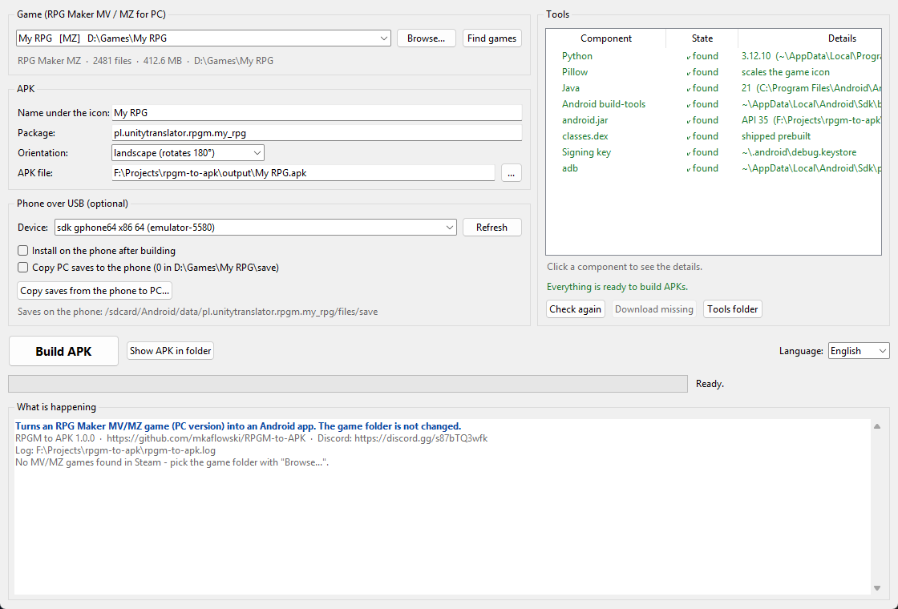

# RPGM to APK

Turns an **RPG Maker MV or MZ** game (the PC version, e.g. from Steam) into a
**native Android app** - one click, no Android Studio, no Gradle.

The game is not emulated. Its HTML5/JavaScript files are packed into a tiny
WebView app and run on the phone's own Chromium engine, so there is no
Winlator / GameNative / Box64 / JoiPlay layer that can freeze, and the game runs
at full speed. The game folder on the PC is never modified.



## Download

Get the latest ZIP from **[Releases](https://github.com/mkaflowski/RPGM-to-APK/releases/latest)**
(~100 KB - the tools it needs are downloaded on the first run, see below).

## Quick start

**Windows**

1. Unpack the whole ZIP anywhere (not in the ZIP preview).
2. Double-click **`gui.bat`**.
3. Pick the game - Steam libraries are searched automatically, or use
   **Browse...** and point to the game folder (or its `Game.exe`).
4. The **Tools** panel shows what is installed. Click **Download missing**
   (or just build - it asks then).
5. Click **Build APK**. The APK appears in the `output` folder.
6. Copy the APK to the phone and open it (allow installing from unknown
   sources), or tick **Install on the phone after building** with the phone
   connected over USB.

**Linux / Steam Deck**

```sh
sh gui.sh        # the window (needs tkinter: pacman -S tk / apt install python3-tk)
sh convert.sh    # console version
```

No Python on Windows? The launchers download a portable one into `.python\` of
the program folder (python-build-standalone, includes tkinter). Nothing is
installed system-wide.

## Two front ends, one engine

|  | Windows | Linux / Steam Deck | needs |
| --- | --- | --- | --- |
| **Window** - pick a game, see what is installed, build, phone over USB | `gui.bat` | `sh gui.sh` | Python 3.10+ with tkinter |
| **Console** - question by question, or fully scripted with options | `convert.bat` | `sh convert.sh` | Python 3.10+ |

Both call the same `rpgm_apk_lib.py` and build identical APKs. The UI is Polish
on a Polish system and English otherwise (switch in the window, or `--lang pl|en`).

Console options:

```
convert.bat --check                               show which tools are installed
convert.bat --game "D:\Games\My RPG"              no question about the game
convert.bat --game "..." --install --push-saves   install via adb + copy PC saves
convert.bat --pull-saves D:\saves --game "..."    copy saves from the phone
convert.bat --orientation any                     landscape (default) / portrait / any
convert.bat --help                                everything else
```

## Tools it needs (and downloads for you)

| tool | why | if missing, downloads |
| --- | --- | --- |
| Java 11+ (`java`, `keytool`) | runs `apksigner`, creates the signing key | Eclipse Temurin JRE 17 (~45 MB) |
| Android build-tools (`aapt2`, `zipalign`, `apksigner`) | manifest, alignment, v2 signature | Google Android SDK repository (~60 MB) |
| `android.jar` (API 30+) | framework resources for `aapt2 link` | Google Android SDK Platform 35 (~60 MB) |
| `adb` - optional | install over USB, copy saves | Google platform-tools (~7 MB) |
| Pillow - optional | scales the game icon | - (the icon goes in unscaled) |

Existing installations are used first (Android Studio, `ANDROID_HOME`,
`JAVA_HOME`, `/usr/lib/jvm`...). Downloads come only from the official sources,
checksums are verified, nothing happens without your consent, and everything
goes into `.tools/` of the program folder - delete the folder and it is all
gone. By downloading Android SDK components you accept the
[Android SDK license](https://developer.android.com/studio/terms).

The compiled Java part of the app (`android/classes.dex`) is shipped, so no JDK
is needed - a JRE is enough.

## Saves

Saves are real files in the **same format as on the PC**, so they can be moved
in both directions:

| | location |
| --- | --- |
| phone | `Android/data/pl.unitytranslator.rpgm.<game>/files/save/` |
| PC (MZ) | `<game folder>/save/` |
| PC (MV) | `<game folder>/www/save/` |

Copy them with a USB cable, with the buttons in the window, or with
`--push-saves` / `--pull-saves`. Building the same game again on the same
computer installs as an **update** and keeps the saves. **Uninstalling the app
deletes its saves** - copy them first.

## Controls

- touch: tap = move / select, two-finger tap = cancel / menu (built into RPG Maker)
- Back button = Esc (cancel / menu)
- gamepad: works when the game supports one on the PC

## What the converter does to the game

Nothing on the PC. Inside the APK:

- the game is served from `https://appassets.androidplatform.net/` - a real
  https origin, because `file://` blocks XHR, `fetch` and WebAssembly (black
  screen); file names are matched case-insensitively (Windows games often
  reference `Img/Foo.png` for `img/foo.png`); video gets HTTP Range support;
- `index.html` gets a `width=device-width` viewport and CSS that stops the page
  from being larger than the screen (no dragging it around); the game is scaled
  by RPG Maker itself, **keeping the aspect ratio** (black bars, never stretched);
- `UT_AndroidBridge.js` is added as the **first** plugin:
  - saves go to files instead of the browser's IndexedDB,
  - `require('fs' | 'path' | 'os')` returns working stand-ins, so PC-only plugin
    code does not crash; any other module throws like Node.js, so
    `try { require('./greenworks') } catch {}` means "no Steam";
    `process` and `nw` stay undefined - `Utils.isNwjs()` is false,
  - MZ's start-up wait for IndexedDB is skipped - in a WebView it sometimes hangs
    and leaves an endless black screen,
  - full screen height on phones (MZ keeps 10 % free for a browser address bar),
  - Back = Esc, audio pauses when the app goes to the background,
  - if the game is still loading after 20 s, a note says what it waits for;
- PC-only files are left out: NW.js runtime, `*.exe` / `*.dll`, Steam
  libraries, `save/`;
- the WebView is recreated when Android kills its renderer (out of memory).

## Troubleshooting

| problem | what to do |
| --- | --- |
| "Not an RPG Maker MV/MZ game" | point to the folder with `index.html`, `js/` and `data/` (for MV often `www/` inside). XP / VX / VX Ace / 2000 / 2003 are not supported. |
| "App not installed" / `INSTALL_FAILED_UPDATE_INCOMPATIBLE` | the phone has the same game built on another computer (another signing key). Copy the saves, uninstall it, install again. |
| phone not listed | enable Developer options -> USB debugging, plug in the cable, accept "Allow USB debugging?" on the phone, click Refresh. |
| game stays black | wait 20 s - a note shows what the game waits for. Then open `chrome://inspect` in desktop Chrome with the phone connected (the WebView allows debugging) or run `adb logcat -s RPGM`. |
| a plugin error on screen | the plugin probably calls NW.js directly. Open an issue with the plugin name and the message. |
| the window does not open (Linux) | install tkinter (`sudo pacman -S tk`, `sudo apt install python3-tk`) or use `sh convert.sh`. |

Logs: `rpgm-to-apk.log` in the program folder.

## Limits

- Only RPG Maker **MV** and **MZ**. Not XP / VX / VX Ace (Ruby RGSS) or
  2000 / 2003 - use JoiPlay or EasyRPG Player for those.
- Games packed into a single `package.nw` or an Enigma Virtual Box exe must be
  unpacked first.
- APK size limit ~3.8 GB (above ~4 GB an APK would need ZIP64, which Android
  cannot install).
- Plugins that call NW.js APIs without checking `Utils.isNwjs()` may still fail.

**Do not share the built APKs** - they contain the game files. Share this tool.

## Development

```
python -m unittest discover -s tests -p "test_lib.py" -v        # unit tests, no network
python tests/test_apk_in_browser.py "output/<Game>.apk" --game "<game folder>"
python cli.py --rebuild-dex ...      # after changing android/MainActivity.java (needs a JDK)
python make_dist.py --clean --zip    # release package -> dist/RPGM-to-APK.zip
```

`tests/test_apk_in_browser.py` (needs Playwright) serves the APK assets exactly
like `MainActivity` does and emulates the Java bridge, then checks that the game
reaches its first scene with no JS errors or 404s, PC saves load, saves
round-trip in the PC format, the `require()` stand-ins work, Back = Esc, the
page cannot scroll and the game is scaled keeping its aspect ratio. It does not
run the Java code - that needs a phone or an emulator.

| file | what |
| --- | --- |
| `rpgm_apk_lib.py` | the engine: game detection, tool status and downloads, APK build, adb |
| `gui.py` / `cli.py` | window / console front ends |
| `android/MainActivity.java` | the WebView app (asset server, file bridge, lifecycle) |
| `android/UT_AndroidBridge.js` | the plugin injected into the game |
| `i18n.py`, `app_config.py` | Polish / English strings, remembered settings |
| `gui.bat`, `convert.bat`, `find_python.bat`, `bootstrap_python.ps1`, `*.sh` | launchers |

---

**Po polsku:** instrukcja w pliku [`JAK-UZYWAC.txt`](JAK-UZYWAC.txt). Program
sam wyświetla się po polsku na polskim systemie.

Discord: https://discord.gg/s87bTQ3wfk
